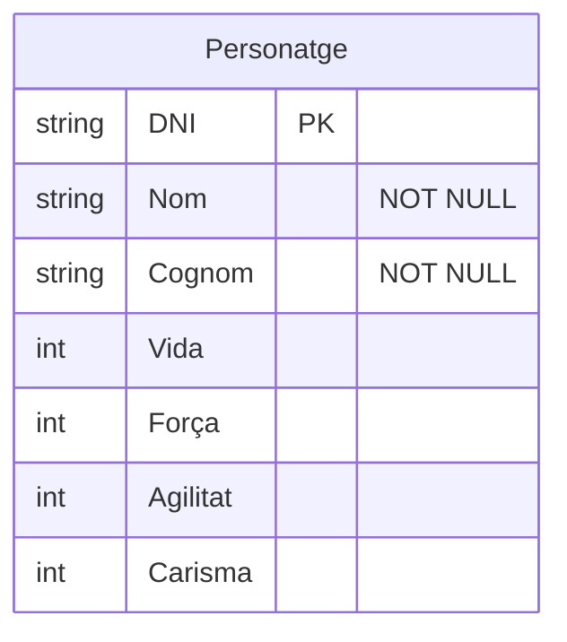

```mermaid

erDiagram
    Personatge {
        string DNI PK
        string Nom "NOT NULL"
        string Cognom "NOT NULL"
        int Vida
        int Força
        int Agilitat
        int Carisma
    }
    Item {
        string Codi PK
        string Nom "NOT NULL"
        Boolean Equipable
        Boolean Comerciable "NOT NULL" 
        string Tipus "NOT NULL"
        int Pes "NOT NULL"
        int Qualitat "NOT NULL"
        float Mesures "X"
        float Mesures "Y"
        float Mesures "Z"
    }
    Mascota {
        string  Num.Chip PK
        string Nom "NOT NULL"
        Boolean Motxilla 
    }
    Enemic {
        string Codi PK
        string Nom "NOT NULL"
        string Tipus "NOT NULL"
        int Nivell 
        int Vida
        int Força
        int Agilitat
        int Carisma
    }
    Habilitat {
        string Codi PK
        string Nom "NOT NULL"
        int Cost 
        int Dany
        float Cooldown
        string Tipus "NOT NULL"
    }

    Personatge }| -- o{ Item: Equipa
    Mascota }| -- o{ Item: Carrega
    Personatge || -- || Mascota: Acompanya
    Personatge }| -- |{ Enemic: Enfrenta
    Personatge }| -- o{ Habilitat: Poseeix
    Enemic }| -- |{ Habilitat: Enfrenta
    Habilitat }| -- |{ Habilitat: combina_amb
```

# Explicació

> [!NOTE]
> Aquest es un diagrama d'entitat-relacio que ens serveix per definir els sistemes mecanics d'un videojoc.

## Entitats

> * Personatge.
> 
> * Enemic.
> 
> * Habilitat.
> 
> * Mascota.
>


## Atributs

> Personatge:
> * DNI (string), (Clau Primaria).
> * Nom (string) (No es pot deixar com a camp buit).
> * Cognom (string) (No es pot deixar com a camp buit)
> * Vida (int)
> * Força (int)
> * Agilitat (int)
> * Carisma (int)



> Item:
> * Codi (string), (Clau Primaria).
> * Nom (string) (No es pot deixar com a camp buit).
> * Equipable (Boolean (Pot ser equipat o pot no ser equipat)) 
> * Comerciable (Boolean (puede ser comerciado o puede ser no comerciado)) (No es pot deixar com a camp buit)
> * Força (int)
> * Agilitat (int)
> * Carisma (int)


## Relacions

> * El Personatge (que n'ha d'haber com a minim un) pot **equipar** molts o ningun item (Aixo ho pensat d'aquesta forma perque es posible que un personatge no jugable no hi tingui equipat res).
>
> * La Mascota (Que n'hi ha d'haguer una com a minim) pot **carregar** molts o ningun item (Aixo ho pensat d'aquesta forma perque una mascota potser no hi fa falta que hi carregui un item obligatoriament).
>
> * El Personatge pot tenir solament una mascota que li **acompanyi**, hi poden ser diferents mascotes, pero solament una pot acompanyar cada vegada.
>
> * El Personatge (que com a minim n'hi ha d'haber-hi 1) pot **enfrentar** a molts o ningun enemics (Aixo ho he pensat de la seguent manera perque hi poden haber-hi personatges que no enfrentin enemics, o potser enemics que no s'enfrentin al personatge).
>
> * El Personatge pot **poseir** ninguna o moltes habilitats (Aixo ho pensat d'aquesta forma ja que pensaba que utilitzar o inclos tenir habilitats era una mecanica opcional).
>
> * L'Enemic (o molts enemics) pot **enfrentarse** a moltes Habilitats (O a una solament) (Aixo ho pensat de la seguent manera ja que es podrien utilitzar diferents habilitats a diferents enemics).
>
> * Les Habilitats (o com a minim una) poden ser **combinades** amb una o altres Habilitats (Aixo ho pensat de la seguent forma per si n'hi ha la posibilitat de fer petites sequences combinant Habilitats).
